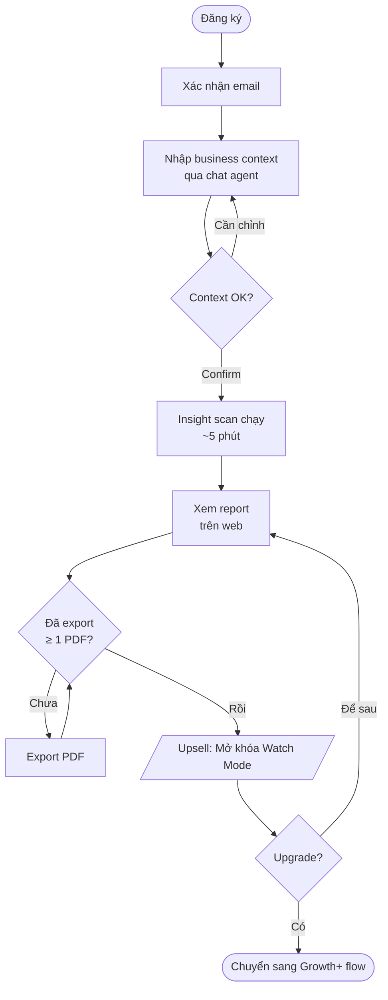
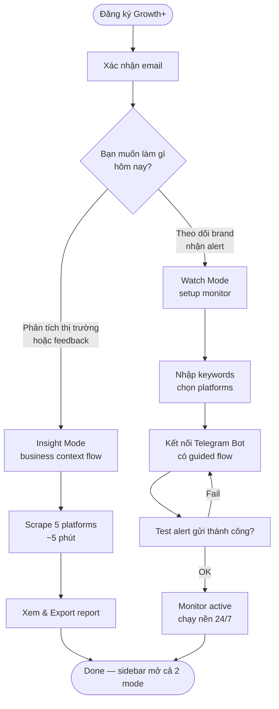
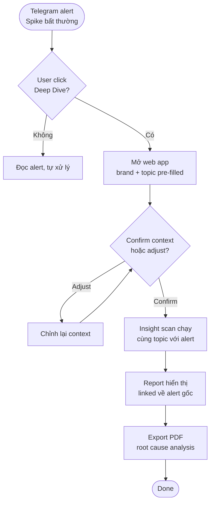

# SocialMind — Agentic Social Intelligence
**Biến hàng ngàn social posts và internal research thành business insight rõ ràng — theo yêu cầu hoặc liên tục tự động, không cần setup phức tạp.**

---

| VERSION | AUTHOR | STATUS | TARGET LAUNCH | PLATFORM | LAST UPDATED |
|---|---|---|---|---|---|
| v2.1 · MVP Final | Product Owner | Draft — In Review | Q2 2026 | Web App (SaaS) + Telegram | March 2026 |

**Insight Mode** — On-demand W-N-P Analysis | **Watch Mode** — Always-on Monitoring & Alerts

---

## TABLE OF CONTENTS

01. Problem Statement
02. Target Users & Personas
03. Jobs To Be Done
04. Solution Overview
05. Success Metrics
06. Scope — In / Out V1
07. Two Modes Explained
08. Shared Infrastructure
09. User Stories & Acceptance Criteria
10. MoSCoW Prioritization
11. Tech Stack & Architecture
12. Pricing & Packaging
13. Product Roadmap
14. Risks & Mitigations
15. Trade-off Decisions
16. Open Questions
17. Onboarding & Mode Separation
18. Go-to-Market & First 10 Users
19. Launch Criteria (Definition of Done)

---

## 01 Problem Statement

Brand manager, Marketing Manager và Product Owner tại các SME và startup Việt Nam **mù thông tin về cảm xúc và tín hiệu thực sự của khách hàng** — không phải vì thiếu data, mà vì không có công cụ phù hợp thị trường Việt Nam để xử lý data đó nhanh chóng, tự động và có cấu trúc.

### Ba vấn đề riêng biệt — Một sản phẩm giải quyết

| VẤN ĐỀ | AI BỊ ẢNH HƯỞNG | HẬU QUẢ | MODE GIẢI QUYẾT |
|---|---|---|---|
| **Research thủ công, chậm và thiếu structure.** Scroll Facebook Groups, TikTok, Reddit tốn 3–5 giờ/tuần. Insight không có evidence, khó thuyết phục stakeholder. | Marketing Manager, Product Owner | Ra quyết định dựa trên cảm tính. Discovery mất 2–4 tuần thay vì vài giờ. | Insight Mode (Social) |
| **Khủng hoảng xảy ra ngoài giờ hành chính.** Brand Manager biết có crisis khi sếp gọi điện — không phải khi nó xảy ra. Check thủ công 1.5h mỗi sáng. | Brand Manager, Marketing Manager | Phản ứng chậm với crisis. Bỏ lỡ trend. Báo cáo sếp thiếu data thực tế. | Watch Mode |
| **Xử lý internal research thủ công.** Team tốn 1+ ngày để tổng hợp 300–400 feedback từ Excel, UT results, user interviews mỗi sprint. Insight đến trễ, không kịp đưa vào sprint tiếp theo. | Product Owner, Designer | Quyết định dựa trên cảm tính. Feature bị lệch. Sprint bị lãng phí. | Insight Mode (File Upload) |
| **Không có tool phù hợp thị trường Việt Nam.** Brandwatch/Mention không cover Facebook, TikTok, Threads VN. | Cả ba persona | Bỏ phí license hoặc quay về manual. Gap thị trường rõ ràng. | Cả hai mode |

> **CORE PROBLEM:** Không có sản phẩm nào trên thị trường Việt Nam hiện tại cung cấp agentic social listening kết hợp on-demand insight, real-time monitoring, và internal research synthesis — phù hợp với Facebook, TikTok, Threads và báo điện tử Việt Nam.

---

## 02 Target Users & Personas

### 👩‍💼 Mai Nguyễn — PRIMARY · MARKETING MANAGER
- **Context:** D2C startup F&B, team 3 người, HCMC
- **Goal:** Hiểu khách hàng đang nói gì để điều chỉnh campaign và phản ứng kịp với thị trường
- **Pain:** Research thủ công tốn thời gian. Không có alert khi brand bị mention bất thường.
- **Dùng Mode:** Insight + Watch
- **Budget:** $30–80/tháng

### 👨‍💻 Minh Trần — SECONDARY · PRODUCT OWNER
- **Context:** SaaS startup Series A, team product 5 người
- **Goal:** Validate product ideas, lấy evidence-backed insight để thuyết phục stakeholder về roadmap
- **Pain:** Discovery tốn 2–3 tuần, insight không có evidence quotes thuyết phục. **Tốn 1+ ngày để tổng hợp thủ công 300–400 feedback từ Excel UT/interview mỗi sprint — đến khi có insight thì đã trễ để đưa vào sprint tiếp theo.**
- **Dùng Mode:** Insight Mode chính (Social + File Upload)
- **Budget:** $50–150/tháng

### 👩 Linh Phạm — SECONDARY · BRAND MANAGER
- **Context:** Công ty FMCG, 28 tuổi, HCMC
- **Goal:** Biết ngay khi có crisis hoặc trend liên quan đến brand. Có summary để báo cáo sếp thứ Hai.
- **Pain:** Biết có khủng hoảng khi sếp gọi — không phải khi nó xảy ra. Check thủ công 1.5h/sáng.
- **Dùng Mode:** Watch Mode chính
- **Budget:** $25–60/tháng

### 🎨 Designer (Secondary — Internal Use)
- **Context:** Member trong product team, cùng team với Minh Trần
- **Goal:** Thấy clustered pain points từ UT và user interviews để iterate UI trong sprint tiếp theo
- **Pain:** Phải đợi PM tổng hợp feedback — không có visibility trực tiếp vào data
- **Dùng Mode:** Insight Mode (nhận report từ File Upload flow)
- **Budget:** Không trả tiền riêng (share với Product Owner)

---

## 03 Jobs To Be Done (JTBD)

User không "mua social listening tool" — họ *hire SocialMind để làm các công việc cụ thể:*

| KHI NÀO | TÔI MUỐN | ĐỂ TÔI CÓ THỂ | MODE |
|---|---|---|---|
| Trước khi lên campaign mới | Biết khách hàng đang nói gì về category — Wants, Needs, Pains | Tạo messaging phù hợp pain thực sự, không phải assumption | Insight (Social) |
| Khi chuẩn bị roadmap quarter mới | Có evidence-backed insight với quotes thuyết phục | Prioritize feature với data thực, không phải cảm tính | Insight (Social) |
| Sau mỗi sprint UT hoặc user interview | Upload file feedback và nhận report tự động trong ngày | Ra quyết định backlog dựa trên data, không mất 1+ ngày tổng hợp | Insight (File Upload) |
| Khi bắt đầu ngày làm việc | Biết ngay điều gì quan trọng xảy ra với brand trong 24h qua | Phản ứng kịp thay vì biết muộn qua người khác | Watch |
| Khi có sự kiện thị trường (trend, scandal) | Nhận alert trong vòng 30 phút khi có spike bất thường | Phản ứng với crisis trước khi nó leo thang | Watch |
| Khi thấy alert spike bất thường | Deep dive ngay vào insight để hiểu root cause | Ra quyết định hành động cụ thể, không chỉ biết "có vấn đề" | Cả hai |
| Khi muốn pitch ý tưởng với ban lãnh đạo | Có report chuyên nghiệp với chart và evidence quotes | Present mà không cần team research riêng | Insight |

---

## 04 Solution Overview

SocialMind là nền tảng SaaS tích hợp **hai chế độ hoạt động bổ sung nhau** trên cùng một web app:

### 🔍 Insight Mode — On-demand (2 input flows)

**Flow 1 — Social Listening:**
User kích hoạt khi cần. Agent hỏi về business context (max 5 câu), sau đó tự động thu thập data từ 5 platforms, phân loại theo W-N-P framework, sinh ra report với chart và evidence quotes, export PDF trong vài phút.
```
INPUT → [Business Context] → [Scrape 5 platforms] → [W-N-P] → [Report + PDF]
```

**Flow 2 — Internal File Upload:** *(Bổ sung v2.1)*
User gửi file Excel/CSV qua email. System tự động detect attachment, parse feedback rows, phân tích sentiment và cluster themes, sinh report và gửi Telegram/Slack alert nếu negative spike ≥ 20 items.
```
EMAIL ATTACHMENT → [Auto-detect] → [Parse Excel/CSV]
→ [Sentiment + Cluster] → [Report + PDF] → [Alert nếu spike]
```

### 👁 Watch Mode — Always-on

Chạy nền 24/7 theo lịch. Tự động scrape data mỗi 60 phút, phát hiện spike bất thường, gửi Telegram alert trong vòng 30 phút. Mỗi 8:00 sáng gửi daily briefing tóm tắt 24h qua.
```
CRON → [Scrape] → [Sentiment] → [Spike?] → [Telegram Alert]
```

### 🔗 Cross-Mode Flow — "Deep Dive"

Khi user nhận Watch Mode alert về spike, họ có thể click "Deep Dive" để tự động khởi chạy Insight Mode scan trên cùng topic đó — chuyển từ "biết có vấn đề" sang "hiểu tại sao" mà không cần nhập lại context.

---

## 05 Success Metrics

**NORTH STAR METRIC:** "Insights Acted Upon per Month" — số lần user export PDF (Insight Mode) hoặc click "Deep Dive" / view full context từ Telegram alert (Watch Mode). Metric này đo được product tạo ra quyết định thực tế, không chỉ generate data.

| METRIC | BASELINE | TARGET (3 THÁNG) | ĐO BẰNG CÁCH NÀO |
|---|---|---|---|
| Time-to-first-insight (Social) | Manual: 3–5 giờ | < 5 phút | Pipeline completion time tracking |
| Internal feedback processing time | Manual: 1+ ngày | < 2 giờ | Pipeline completion time |
| Alert latency (Watch) | Manual: phát hiện muộn / không phát hiện | < 30 phút | Timestamp spike detection → Telegram delivery |
| Weekly active analyses | 0 | 10+ analyses/tuần | App analytics |
| Watch Mode activation rate | — | ≥ 60% paid users setup ≥ 1 monitor | Monitor creation events |
| PDF export rate | — | ≥ 60% sessions có export | Export button click tracking |
| Daily briefing delivery accuracy | — | 8:00 ± 5 phút, ≥ 5 ngày liên tiếp | Telegram delivery timestamp |
| Data-driven decisions (PM) | ~30% decisions có data | ≥ 50% | Backlog items tagged with feedback source |
| D7 Retention | — | ≥ 30% | Return visits tracking |
| Usability score (SUS) | — | ≥ 75/100 | 5 user test sessions |
| Sentiment accuracy | — | > 75% | Claude API phân loại đúng trên 50 post test tiếng Việt |

**3 Key Metrics highlight:**
- **< 5'** Time-to-first-insight (Social)
- **< 30'** Alert latency (Watch)
- **> 75%** Sentiment accuracy

---

## 06 Scope — In / Out of V1

### ✅ IN SCOPE — V1

**INSIGHT MODE — SOCIAL FLOW**
- 🟢 Business context agent (multi-turn Q&A, max 5 câu)
- 🟢 Scraping: Facebook Groups, TikTok, Threads, Reddit, Báo chí
- 🟢 W-N-P classification bằng Claude API
- 🟢 Insight report: top 5/category + evidence quotes + chart
- 🟢 PDF export chuyên nghiệp
- 🟢 Job history (xem lại các analysis cũ)

**INSIGHT MODE — FILE UPLOAD FLOW** *(Bổ sung v2.1)*
- 🟢 Email listener tự động detect file attachment
- 🟢 Parse Excel/CSV feedback (300–400 rows)
- 🟢 Sentiment analysis + theme clustering từ internal data
- 🟢 Auto insight report (same format as Social flow)
- 🟢 Telegram alert khi negative items ≥ 20

**WATCH MODE**
- 🟢 Monitor config: keywords + 2 platforms (Facebook Page + TikTok)
- 🟢 Spike detection (3x volume so với trung bình 7 ngày)
- 🟢 Real-time Telegram alert (< 30 phút) — Option B format
- 🟢 Daily briefing tự động 8:00 sáng qua Telegram
- 🟢 Guided Telegram bot connection flow với test message

**SHARED**
- 🟢 Web App (React + FastAPI)
- 🟢 User authentication cơ bản
- 🟢 Usage dashboard (Apify credits + Claude tokens)
- 🟢 "Deep Dive" cross-mode flow
- 🟢 Stripe subscription (Checkout hosted)

### ❌ OUT OF SCOPE — V1

- 🔴 Twitter/X scraping (API cost cao, low priority VN market)
- 🔴 Multi-brand monitoring (Watch Mode chỉ 1 brand)
- 🔴 Google Slides export (chỉ PDF trong V1)
- 🔴 Team collaboration / shared workspace
- 🔴 Real-time streaming dashboard (Telegram là interface Watch)
- 🔴 Competitor comparison report
- 🔴 Weekly Watch Mode report (V1 chỉ có daily briefing)
- 🔴 Slack delivery channel (chỉ Telegram trong V1)
- 🔴 API access cho third-party
- 🔴 Mobile app
- 🔴 Niche Finder / Solution Engine (V2)
- 🔴 White-label / agency mode
- 🔴 Interview transcript analysis (V2 — chỉ Excel/CSV trong V1)

> **SCOPE PRINCIPLE:** V1 cần hoàn chỉnh 3 luồng từ đầu đến cuối: (1) Insight Mode Social: user nhập context → scrape 5 platforms → W-N-P report → PDF. (2) Insight Mode File: email attachment → parse → analyze → report → alert. (3) Watch Mode: user setup monitor → n8n cron 24/7 → Telegram alert + daily briefing. Không thêm feature ngoài danh sách trên.

---

## 07 Two Modes Explained

### Insight Mode — Flow 1: Social Listening

| BƯỚC | ACTION | ACTOR | OUTPUT |
|---|---|---|---|
| 1 | User mô tả brand, category, và câu hỏi nghiên cứu qua chat interface | User + Business Context Agent | Structured business context |
| 2 | System confirm context, user approve | System | Context summary card |
| 3 | FastAPI trigger Apify actors song song trên 5 platforms | FastAPI + Apify | Raw posts stored in DB với progress tracking real-time |
| 4 | Claude API phân loại từng post theo W-N-P + extract key themes | Claude Sonnet | Classified post dataset |
| 5 | System tổng hợp top 5 insight/category + evidence quotes + charts | Claude Sonnet + Report Engine | Insight report (web view) |
| 6 | User export PDF | User + PDF Engine | Professional PDF với cover, summary, charts, quotes |

### Insight Mode — Flow 2: Internal File Upload *(Bổ sung v2.1)*

| BƯỚC | ACTION | ACTOR | OUTPUT |
|---|---|---|---|
| 1 | User gửi file Excel/CSV qua email | User | Email với attachment |
| 2 | Email listener detect attachment tự động | Email Listener (FastAPI) | File detected + queued |
| 3 | Parse Excel → extract feedback rows (300–400 rows) | FastAPI + Parser | Structured feedback dataset |
| 4 | Sentiment analysis + theme clustering | Claude Sonnet | Classified rows: positive/neutral/negative + top themes |
| 5 | Generate insight report | Report Engine | Web view: top themes, sentiment breakdown, top 5 pain points |
| 6 | Negative items ≥ 20? → Send Telegram alert (Option B format) | n8n logic + Telegram Bot | Alert message trong 30 phút |
| 7 | User export PDF | User + PDF Engine | Professional PDF |

**Alert Format — Option B (Watch + File Upload):**
```
🚨 Sentiment Alert | [Source: feedback_march.xlsx / Brand Watch]
──────────────────────────────────────────
⚠️  Negative: 23 items (+15% vs last batch)
🔥 Top issue: "[verbatim quote from top pain point]"
📎 View full report: [link]
```

### Watch Mode — Always-on Monitoring

| BƯỚC | ACTION | ACTOR | OUTPUT |
|---|---|---|---|
| Setup | User config keywords, platforms (FB + TikTok), sensitivity threshold, kết nối Telegram | User + Web App | Active monitor record trong DB |
| Cron/60' | n8n trigger Apify scrape delta posts (chỉ posts mới trong 60 phút qua) | n8n + Apify | New posts stored in DB |
| Analyze | Claude Haiku phân tích sentiment tiếng Việt cho từng post | Claude Haiku | Sentiment score + label |
| Spike? | System so sánh volume giờ hiện tại vs trung bình 7 ngày | n8n logic | Spike detected hoặc normal |
| Alert | Nếu spike: n8n gửi Telegram message — Option B format | n8n + Telegram Bot | Alert message trong 30 phút |
| Daily 8:00 | n8n tổng hợp 24h qua, gửi daily briefing qua Telegram | n8n + Claude Haiku | Briefing: total mentions, sentiment ratio, top post, 1 notable trend |

---

## 08 Shared Infrastructure

Hai modes dùng chung Data Acquisition Layer và Intelligence Layer — giảm chi phí và tăng coherence của data:

```
DELIVERY LAYER
├── React Web App (Insight reports, config, history)
└── Telegram Bot (Watch alerts, daily briefing, File Upload alerts)

ORCHESTRATION LAYER
├── FastAPI Backend (Insight Mode job runner, File Upload parser, auth, PDF)
└── n8n Workflows (Watch Mode scheduler, spike logic, Telegram, email listener)

INTELLIGENCE LAYER — SHARED
├── Claude Sonnet (Insight: W-N-P + narrative + File Upload clustering — 200K tokens/job)
└── Claude Haiku (Watch: Sentiment scoring + spike summary — 10K tokens/run)

DATA ACQUISITION LAYER — SHARED
├── Facebook Actor (Groups: Insight / Pages: Watch)
├── TikTok Actor (Hashtag + keyword)
├── Threads Actor (Insight Mode V1)
├── Reddit Actor (Insight Mode V1)
├── News Actor (Báo điện tử VN)
└── Email Listener (File Upload trigger — NEW v2.1)

STORAGE LAYER
├── PostgreSQL / Supabase (Posts, jobs, monitors, insights, alerts, uploaded files metadata. 90-day TTL raw posts)
└── Supabase Storage (Generated PDF files)
```

> **COST OPTIMIZATION:** Nếu user chạy Insight Mode Social scan trên brand họ đang Watch, system sẽ reuse cached posts < 2 giờ tuổi từ Watch Mode scrape gần nhất — tránh duplicate Apify call, tiết kiệm ~40% chi phí scraping per user.

---

## 09 User Stories & Acceptance Criteria

### US-001 | Insight Mode | Must | Business Context Onboarding

**As a** Marketing Manager, **I want to** khai báo brand và câu hỏi nghiên cứu qua chat interface thay vì điền form, **so that** agent hiểu đúng context và phân tích data relevant với business của tôi.

**Acceptance Criteria:**
- ✓ Agent hỏi tối đa 5 câu có cấu trúc: brand name, industry, ICP, competitors, research question
- ✓ User có thể skip bất kỳ câu nào mà không bị block — system dùng defaults
- ✓ System hiển thị context summary card để user confirm trước khi chạy analysis
- ✓ Toàn bộ Q&A hoàn thành dưới 3 phút

---

### US-002 | Insight Mode | Must | Data Collection Progress

**As a** Product Owner, **I want to** thấy tiến trình thu thập data real-time, **so that** tôi biết hệ thống đang hoạt động và không bỏ cuộc giữa chừng.

**Acceptance Criteria:**
- ✓ Hiển thị số posts đã thu thập, platform đang scrape, và ETA
- ✓ Nếu quá 3 phút không có cập nhật, hiển thị trạng thái rõ ràng (stalled / retry)
- ✓ User có thể cancel và restart mà không mất context đã nhập
- ✓ Nếu một platform fail, job tiếp tục với các platform còn lại và flag nguồn bị thiếu trong report

---

### US-003 | Insight Mode | Must | W-N-P Insight Report

**As a** Marketing Manager, **I want to** xem báo cáo phân loại Wants / Needs / Pains với chart và evidence quotes, **so that** tôi có data thuyết phục để trình bày với stakeholder.

**Acceptance Criteria:**
- ✓ Report hiển thị top 5 insights cho mỗi nhóm W/N/P
- ✓ Mỗi insight có ít nhất 2 verbatim quotes kèm platform source và post date
- ✓ Chart hiển thị volume và % phân bổ giữa 3 nhóm W/N/P
- ✓ Tổng thời gian từ onboarding → report hoàn chỉnh < 5 phút

---

### US-004 | Insight Mode | Must | PDF Export

**As a** Product Owner, **I want to** export report ra file PDF chuyên nghiệp, **so that** tôi có thể gửi cho stakeholder mà không cần chỉnh sửa thêm.

**Acceptance Criteria:**
- ✓ PDF gồm: cover page (brand + date), executive summary, W-N-P charts, top insights, evidence quotes, source list
- ✓ File được generate trong dưới 60 giây sau khi click export
- ✓ File name format: SocialMind_[BrandName]_[YYYY-MM-DD].pdf
- ✓ PDF readable trên cả desktop và mobile

---

### US-005 | Watch Mode | Must | Watch Mode Setup & Telegram Connection

**As a** Brand Manager, **I want to** setup monitor cho brand với guided flow và test Telegram connection trước khi activate, **so that** tôi không phát hiện bot bị misconfigure chỉ khi miss alert thật.

**Acceptance Criteria:**
- ✓ Setup flow gồm: keywords → platforms → sensitivity threshold → Telegram Chat ID
- ✓ System gửi test message sau khi user nhập Chat ID
- ✓ User phải confirm receipt trong web UI trước khi monitor activate
- ✓ Nếu test message fail, UI hiển thị lỗi cụ thể (Chat ID not found / Bot blocked)
- ✓ Monitor có thể pause/resume mà không cần delete và recreate

---

### US-006 | Watch Mode | Must | Real-time Spike Alert

**As a** Brand Manager, **I want to** nhận Telegram alert trong vòng 30 phút khi có spike bất thường về brand mentions, **so that** tôi không phải là người cuối cùng biết khi crisis xảy ra.

**Acceptance Criteria:**
- ✓ Alert trigger khi volume 1 giờ vượt threshold đã set (default 3x trung bình 7 ngày)
- ✓ Alert format Option B: spike magnitude + top issue (verbatim) + sentiment breakdown + report link
- ✓ Alert delivered trong 30 phút kể từ khi spike window đóng
- ✓ User có thể chọn sensitivity: High (1.5x), Medium (3x), Low (5x) — configurable per monitor

---

### US-007 | Watch Mode | Must | Daily Briefing via Telegram

**As a** Brand Manager, **I want to** nhận daily briefing 8:00 sáng mỗi ngày tóm tắt 24h qua, **so that** tôi có situational awareness ngay từ đầu ngày mà không cần check thủ công.

**Acceptance Criteria:**
- ✓ Briefing đến 8:00–8:05 AM Vietnam time (UTC+7) mỗi ngày
- ✓ Nội dung gồm: total mentions, sentiment ratio (pos/neu/neg), top post của ngày, 1 notable trend viết bằng tiếng Việt
- ✓ Nếu không có mentions trong 24h, gửi "Không có hoạt động đáng chú ý" thay vì skip
- ✓ Chạy ổn định ≥ 5 ngày liên tiếp không cần can thiệp thủ công

---

### US-008 | Cross-Mode | Must | "Deep Dive" — Watch → Insight Flow

**As a** Marketing Manager dùng cả hai modes, **I want to** click "Deep Dive" từ Watch alert để launch Insight scan ngay trên topic đó, **so that** tôi chuyển từ "biết có vấn đề" sang "hiểu root cause" mà không cần nhập lại context.

**Acceptance Criteria:**
- ✓ "Deep Dive" action trên Telegram alert mở web app với Insight Mode onboarding đã pre-fill brand + spike topic
- ✓ User chỉ cần confirm hoặc adjust trước khi job chạy — không cần nhập lại từ đầu
- ✓ Insight report kết quả được linked back về alert gốc trong job history
- ✓ Dashboard cập nhật trong vòng 5 phút sau khi job hoàn thành

---

### US-009 | Cross-Mode | Must | Usage Dashboard

**As a** startup founder quản lý chi phí, **I want to** thấy usage dashboard hiển thị Apify credits và Claude tokens đã dùng trong billing period, **so that** tôi không bị bất ngờ bởi overage charge.

**Acceptance Criteria:**
- ✓ Hiển thị: credits used / credits included, estimated cost, projection end-of-month
- ✓ Gửi Telegram hoặc email warning khi đạt 80% usage

---

### US-010 | Insight Mode | Must | Internal File Upload & Auto Analysis *(Bổ sung v2.1)*

**As a** Product Owner, **I want to** gửi file Excel feedback qua email và nhận insight report tự động trong cùng ngày, **so that** tôi ra quyết định backlog dựa trên data thay vì mất 1+ ngày tổng hợp thủ công.

**Acceptance Criteria:**
- ✓ System tự động detect email attachment — không cần manual upload
- ✓ Hỗ trợ format: .xlsx, .xls, .csv
- ✓ Xử lý 300–400 feedback rows trong dưới 2 giờ
- ✓ Report gồm: top themes, sentiment breakdown (pos/neu/neg), top 5 pain points với verbatim quotes
- ✓ Nếu negative items ≥ 20: gửi Telegram alert theo Option B format
- ✓ Zero manual steps sau khi gửi email
- ✓ Report PDF có thể export với cùng format như Social flow
- ✓ Raw file không được lưu sau khi parse xong (privacy)

---

### US-011 | Insight Mode | Must | Designer Pain Point View *(Bổ sung v2.1)*

**As a** Designer trong product team, **I want to** xem clustered pain points từ UT và user interview feedback, **so that** tôi biết UI flow nào cần iterate trong sprint tới mà không cần đợi PM tổng hợp.

**Acceptance Criteria:**
- ✓ Report hiển thị pain points được group theo UI area / feature area
- ✓ Mỗi cluster có số lượng mentions và severity score
- ✓ Designer có thể access report qua shared link (không cần account riêng trong V1)

---

## 10 MoSCoW Prioritization

### 🔴 Must Have (V1 Launch)
- Business context agent (multi-turn, max 5Q)
- Apify scraping: FB Groups, TikTok, Threads, Reddit, News
- W-N-P classification (Claude Sonnet)
- Insight report với top findings + evidence quotes
- PDF export
- Job history & saved reports
- **Email attachment listener (auto-trigger)** *(Bổ sung v2.1)*
- **Internal Excel/CSV file parser** *(Bổ sung v2.1)*
- **Sentiment + clustering cho internal feedback** *(Bổ sung v2.1)*
- Watch Mode monitor config (FB Page + TikTok)
- Spike detection + Telegram alert (<30 phút) — Option B format
- Daily briefing 8:00 AM qua Telegram
- Telegram bot guided setup + test message
- "Deep Dive" cross-mode flow
- Usage dashboard (credits + tokens)
- User authentication + Stripe subscription

### 🟡 Should Have (V1 nếu kịp)
- Sentiment trend chart theo thời gian (Insight)
- Weekly Watch Mode report qua Telegram
- Re-run Insight job với pre-filled parameters
- Email fallback khi Telegram alert fail
- Insight quality feedback (thumbs up/down)
- Watch Mode: alert sensitivity per monitor
- Alert history trong web app
- **Slack delivery cho File Upload alerts** *(Bổ sung v2.1)*

### 🔵 Could Have (V2)
- Competitor comparison report (Insight)
- Multi-brand monitoring (Watch)
- Slack delivery channel
- Google Slides export
- Email report scheduling
- Team workspace (invite members)
- Twitter/X scraping
- Google Reviews scraping
- Custom alert rules (sentiment-based, không chỉ volume)
- Custom PDF branding (logo upload)
- Insight follow-up Q&A ("dig deeper")
- Niche Finder / Gap scoring algorithm
- **Interview transcript analysis (.docx, audio)** *(Bổ sung v2.1)*

### ⚫ Won't Have (Not this version)
- Real-time streaming dashboard
- Mobile app (iOS/Android)
- API access for third-party
- White-label / agency mode
- CRM integration (Salesforce, HubSpot)
- LinkedIn scraping
- AI-generated response suggestions
- Data retention > 90 days

---

## 11 Tech Stack & Architecture

| COMPONENT | TECH | LÝ DO |
|---|---|---|
| Frontend | React 18 + TypeScript + shadcn/ui (Tailwind) + Recharts | Build UI nhanh. Recharts tương thích PDF. |
| Backend | FastAPI (Python) | Async performance tốt. Python ecosystem phù hợp AI/scraping. |
| Watch Orchestrator | n8n (self-hosted) | Visual workflow, built-in cron, retry, Telegram node. Không cần code scheduler. |
| **Email Listener** | **FastAPI + IMAP/SMTP (Python imaplib)** | **Auto-detect attachment. Simple integration với existing FastAPI.** *(Bổ sung v2.1)* |
| Data Acquisition | Apify Platform | Managed actors, shared pool cả 2 modes. |
| AI — Insight | Claude Sonnet | Deep W-N-P synthesis + internal feedback clustering. 200K tokens/job. |
| AI — Watch | Claude Haiku | Cost-efficient sentiment scoring. 720 runs/tháng. |
| Database | PostgreSQL (Supabase) | Managed DB + Auth + Storage. 90-day TTL raw posts. |
| Delivery | Telegram Bot API | Phổ biến tại VN. n8n built-in node. |
| Payment | Stripe Checkout | Minimal integration. Đủ cho V1. |
| Hosting | Vercel (Frontend) + Railway (FastAPI + n8n + PostgreSQL) | Free tier + usage-based. Phù hợp MVP. |
| Monitoring | GitHub Actions + Sentry + Uptime Robot | Watch Mode always-on — alert ngay khi n8n fail. |

### Estimated Infrastructure Cost per User (Growth tier, Watch Mode active)

| SERVICE | USAGE | COST/THÁNG |
|---|---|---|
| Apify | Hourly Watch scrape (2 platforms) + 4 Insight runs | ~$10 |
| Claude API | Haiku Watch (720 runs × 10K tokens) + Sonnet Insight (4 × 200K tokens) | ~$7 |
| Infrastructure share (Railway, Vercel, Supabase) | Amortized across users | ~$3 |
| **Total cost/user** | | **~$20/tháng** |

> Growth tier pricing $59/tháng → gross margin ~66% per user. Watch Mode-only users on Starter tier ($25) tạo ra negative margin — Watch Mode phải được gated từ Growth tier trở lên.

---

## 12 Pricing & Packaging

| | Starter | Growth ⭐ | Pro |
|---|---|---|---|
| **Giá** | $25/tháng | $59/tháng | $129/tháng |
| | Insight only | Most popular | Power users |
| Insight Mode scans | 10/tháng | Unlimited | Unlimited |
| Platforms | 5 (FB, TikTok, Threads, Reddit, News) | 5 platforms | 5 platforms |
| W-N-P report + PDF | ✓ | ✓ | ✓ |
| **File Upload (Excel/CSV)** | **5 files/tháng** | **Unlimited** | **Unlimited** |
| Job history | 30 ngày | 90 ngày | 90 ngày |
| Watch Mode | ✗ | 1 active monitor | 3 active monitors |
| Telegram alerts | ✗ | ✓ | ✓ |
| Daily briefing | ✗ | ✓ | ✓ |
| "Deep Dive" flow | ✗ | ✓ | ✓ |
| Weekly auto Watch report | ✗ | ✗ | ✓ |
| Competitor comparison | ✗ | ✗ | V1.5 |
| Custom sensitivity rules | ✗ | ✗ | ✓ |
| Priority support | ✗ | ✗ | ✓ |
| Early access V2 | ✗ | ✗ | ✓ |

**Free trial:** 3 Insight scans + 2 File Uploads + 7 ngày Watch Mode — usage-limited để user experience value trước khi có time pressure.

---

## 13 Product Roadmap

### V1 · MVP — Social Intelligence Foundation — Q2 2026 (8 tuần)

- → **Tuần 1–2:** Infrastructure — PostgreSQL schema, Supabase setup, Apify actor testing (5 platforms), n8n self-hosted deployment, **email listener setup**
- → **Tuần 3–4:** Insight Mode Social — Business context agent, scraping pipeline, W-N-P classification, report generation
- → **Tuần 4–5:** Insight Mode File Upload — Email listener, Excel/CSV parser, sentiment + clustering pipeline, alert logic *(Bổ sung v2.1)*
- → **Tuần 5–6:** Watch Mode — Monitor config, spike detection, Telegram alert (Option B), daily briefing cron
- → **Tuần 6:** "Deep Dive" cross-mode flow + Usage dashboard
- → **Tuần 7:** PDF export, Stripe integration, auth flow
- → **Tuần 8:** 5 usability test sessions → iterate → public launch

### V2 · Ext — Intelligence Expansion — Q3 2026

- → Competitor monitoring (Watch Mode): track 2 brands song song
- → Insight Mode: comparative report (brand A vs B)
- → Multi-user workspace (invite ≤3 team members)
- → Weekly Watch Mode auto-report qua Telegram
- → Slack delivery channel
- → Custom alert rules: trigger theo sentiment, không chỉ volume
- → Insight follow-up Q&A ("dig deeper")
- → Google Reviews scraping
- → **Interview transcript analysis (.docx format)**

### V3 — Scale & Enterprise — Q4 2026

- → Niche Finder: gap scoring algorithm dựa trên W-N-P data tổng hợp
- → API access tier (programmatic report generation)
- → Custom report branding (logo, white-label lite)
- → Trend forecasting: Claude-generated 7-day prediction từ Watch Mode history
- → Competitor intelligence dashboard với share-of-voice
- → Twitter/X scraping (nếu API cost hợp lý)

---

## 14 Risks & Mitigations

| LEVEL | RISK | MITIGATION |
|---|---|---|
| HIGH | **Scraping bị block / Platform ToS.** Facebook, TikTok, Threads có thể break Apify actors bất kỳ lúc nào. | Chỉ scrape public content. Graceful degradation: job tiếp tục với platform còn lại, flag missing source trong report. Monitor actor success rate >95%. |
| HIGH | **Sentiment accuracy thấp cho tiếng Việt slang.** Tiếng Việt codeswitching với English và slang thế hệ Z khó cho LLM. Accuracy <75% khiến user không trust output. | Test set 50 post với đánh giá thủ công trước khi launch. Fine-tune prompt theo từng content type. Show confidence indicator trên từng insight. |
| MED | **n8n failure = Watch Mode outage.** n8n là single point of failure cho toàn bộ Watch Mode. | Uptime Robot monitor n8n health. Alert PO ngay khi workflow fail. Runbook restart trong <15 phút. Consider n8n Cloud cho V2. |
| MED | **Apify cost overrun khi scale.** Watch Mode chạy 24/7 per monitor. | Hard cap usage per plan tier. 2h post cache. Monitor cost per user hàng tuần. Gate Watch Mode từ Growth tier. |
| MED | **False positive alert fatigue.** Threshold quá thấp → user nhận quá nhiều alert không relevant. | Default threshold 3x (medium). User tự chỉnh sensitivity. Track alert open rate — nếu <30%, proactively suggest threshold increase. |
| MED | **Data privacy — uploaded files.** Excel feedback files có thể chứa PII của khách hàng (tên, email). Vi phạm PDPA nếu xử lý không đúng. *(Bổ sung v2.1)* | Không lưu raw file sau khi parse. Chỉ store derived insights. Document rõ trong ToS: "Do not upload files containing personal data." Hiển thị warning khi upload. |
| LOW | **Telegram không phổ biến với enterprise users.** Một số brand manager ở công ty lớn không dùng Telegram cá nhân. | Telegram-only trong V1. Email fallback trong "Should Have". Slack trong V2. |
| LOW | **Email listener reliability.** IMAP polling có thể miss emails nếu server chậm hoặc filter spam. *(Bổ sung v2.1)* | Polling interval 5 phút. Retry logic 3 lần. Confirm email trong web UI sau khi system nhận. Fallback: manual upload URL nếu email fail. |

---

## 15 Trade-off Decisions

*Ghi lại các quyết định khó và lý do đằng sau — phần quan trọng nhất để demonstrate PO thinking.*

### ⚖️ Build cả hai modes trong V1 thay vì một mode duy nhất
**Quyết định:** V1 ship cả Insight Mode và Watch Mode.
**Lý do:** Shared infrastructure (Apify + Claude) nghĩa là cost của việc build cả hai < build từng cái riêng lẻ. Cross-mode "Deep Dive" flow là differentiator mà không có tool nào khác có.
**Rủi ro chấp nhận:** Scope lớn hơn, delay launch risk. Giảm bằng cách scope rất chặt trong từng mode.

---

### ⚖️ Thêm File Upload Flow vào Insight Mode trong V1 thay vì defer V2 *(Bổ sung v2.1)*
**Quyết định:** Build email-triggered file upload ngay trong V1, không defer.
**Lý do:** Product Owner persona (Minh Trần) có pain rõ ràng và ngay lập tức — 1+ ngày xử lý internal feedback. File Upload reuse toàn bộ Intelligence Layer đã build cho Social Flow (Claude Sonnet + Report Engine). Incremental build cost thấp, nhưng giải quyết một pain point hoàn toàn khác của cùng persona.
**Rủi ro chấp nhận:** Thêm email listener component mới. Privacy risk nếu user upload PII. Giảm bằng data handling policy rõ ràng và warning UI.

---

### ⚖️ n8n + FastAPI (2 orchestrators) thay vì 1 unified backend
**Quyết định:** n8n cho Watch Mode scheduling, FastAPI cho Insight Mode và File Upload.
**Lý do:** n8n ideal cho always-on scheduling. FastAPI xử lý synchronous flows rõ ràng hơn. Velocity gain lớn hơn maintenance cost cho 1-person team.
**Rủi ro chấp nhận:** 2 systems để deploy và debug. Re-evaluate V2.

---

### ⚖️ Telegram là Watch Mode interface — không có web dashboard cho alerts
**Quyết định:** Watch Mode dùng Telegram cho toàn bộ alert delivery trong V1.
**Lý do:** Telegram đủ để validate use case. Real-time web dashboard cần WebSocket, phức tạp hơn nhiều.
**Rủi ro chấp nhận:** Users không dùng Telegram không thể dùng Watch Mode. Email fallback trong "Should Have".

---

### ⚖️ PostgreSQL từ đầu thay vì Google Sheets
**Quyết định:** Dùng PostgreSQL (Supabase) là canonical store.
**Lý do:** Google Sheets không có relational queries, indexing, concurrency. Migrate V2 sẽ rất đau. Supabase managed trong 1 platform giảm DevOps overhead.
**Rủi ro chấp nhận:** Setup phức tạp hơn Sheets một chút.

---

### ⚖️ Claude Haiku cho Watch Mode, Sonnet cho Insight Mode + File Upload
**Quyết định:** Haiku cho Watch sentiment scoring, Sonnet cho tất cả deep synthesis.
**Lý do:** Watch chạy 720 lần/tháng — Sonnet sẽ cost $50+ chỉ cho AI layer. File Upload cần deep clustering — Sonnet là investment đúng chỗ, user chủ động trigger và có tolerance cho cost cao hơn.
**Rủi ro chấp nhận:** Haiku có thể accuracy thấp hơn cho slang tiếng Việt. Sẽ benchmark trên test set trước khi lock.

---

### ⚖️ Watch Mode scrape 2 platforms trong MVP thay vì 5
**Quyết định:** Watch Mode V1 chỉ monitor Facebook Page + TikTok.
**Lý do:** Watch Mode chạy 24/7 — mỗi platform thêm vào tăng cost và failure surface đáng kể. FB + TikTok là 2 nguồn volume cao nhất tại VN.
**Rủi ro chấp nhận:** User có thể miss mentions trên Reddit/Threads — bù đắp bằng Insight Mode khi cần deep research.

---

## 16 Open Questions

| # | CÂU HỎI | IMPACT NẾU SAI | CẦN TRẢ LỜI TRƯỚC | STATUS |
|---|---|---|---|---|
| HIGH | Apify actors cho Facebook, TikTok, Threads, Reddit có production-stable cho content tiếng Việt không? Rate limit và ToS từng platform ra sao? | Toàn bộ data pipeline phải redesign | Sprint 1 bắt đầu | Open |
| HIGH | Watch Mode scrape frequency tối ưu là bao nhiêu? 30 phút cho latency tốt hơn nhưng đôi Apify cost. 60 phút rẻ hơn nhưng có thể miss short-lived spikes. | Ảnh hưởng alert latency SLA và cost model | Architecture finalized | Open |
| MED | Watch Mode có nên available trên Starter tier không? Hay gate từ Growth? Cost per Watch Mode user ~$20/tháng — Starter $25 → negative margin. | Pricing model và user acquisition funnel | Pricing decision locked | Proposed: Gate to Growth |
| MED | Claude Haiku có đủ accuracy cho sentiment tiếng Việt với slang/codeswitching không? | Nếu không đủ, Watch Mode cost tăng 3–4x | Sprint 2 kết thúc | Open |
| MED | Free trial nên time-limited (14 ngày) hay usage-limited (3 Insight scans + 7 ngày Watch + 2 File Uploads)? | Ảnh hưởng activation rate và trial-to-paid conversion | V1 launch | Proposed: Usage-limited |
| MED | n8n: self-hosted trên Railway (~$10/tháng) hay n8n Cloud (~$20–50/tháng)? Budget <$50/tháng infra. | Ảnh hưởng operational overhead cho 1-person team | Sprint 1 bắt đầu | Open |
| MED | Alert delivery cho File Upload flow: Telegram hay Slack? Internal users (PM/Designer) thường dùng Slack hơn Telegram cho công việc. *(Bổ sung v2.1)* | Ảnh hưởng adoption của internal use case | V1 launch | Open |
| MED | Email listener: monitor 1 email address chuyên dụng (vd: feedback@socialmind.app) hay user kết nối email cá nhân qua OAuth? *(Bổ sung v2.1)* | Ảnh hưởng security model và onboarding complexity | Sprint 1 | Proposed: Dedicated email address per user |
| LOW | Sharing trong V1: nếu PM và Designer cùng muốn xem report, cơ chế share là gì? PDF email, shared link, hay không support? | Ảnh hưởng activation nếu user cần chia sẻ | V1 launch | Proposed: PDF share only |
| LOW | Data retention policy: raw scraped posts (potential ToS sensitivity) có nên giữ 90 ngày như derived insights không, hay shorter TTL? | Storage cost + legal risk | V1 launch (PDPA consideration) | Open |
| LOW | File Upload: có nên giới hạn file size không? Và số cột tối thiểu cần có trong Excel để system parse được? *(Bổ sung v2.1)* | Ảnh hưởng parser reliability | Sprint 4 | Open |

---

## 17 Onboarding & Mode Separation *(Bổ sung v2.2)*

### Vấn đề

Insight Mode và Watch Mode giải quyết **2 mental model khác nhau hoàn toàn**:

| | Insight Mode | Watch Mode |
|---|---|---|
| **User nghĩ mình là** | Nhà phân tích | Người canh gác |
| **Mục tiêu** | Hiểu quá khứ / xu hướng | Phản ứng với hiện tại |
| **Tư duy** | Chậm, suy nghĩ sâu | Nhanh, alert-driven |
| **Câu hỏi trong đầu** | "Điều gì đang xảy ra?" | "Có gì bất thường không?" |

Nếu gộp cả 2 mode vào 1 dashboard mà không phân tách rõ → user mới bị cognitive overload ngay lần đầu đăng ký → friction onboarding cao → drop-off sớm.

### Quyết định

**Tách 2 mode rõ ràng từ lúc onboarding, dựa trên pricing tier:**

1. **Starter ($25):** Chỉ thấy Insight Mode — Watch Mode bị ẩn hoàn toàn, không hiển thị icon lock gây distraction.
2. **Growth+ ($59):** Onboarding hỏi use case trước khi vào dashboard.

### Onboarding Flow

**Luồng Starter:**
```
Đăng ký → Nhập business context → Chạy Insight analysis → Xem report → (Upsell Watch sau khi có 1 report đầu tiên)
```

**Luồng Growth+:**
```
Đăng ký → "Bạn muốn làm gì hôm nay?"
              ├── [Phân tích thị trường / đối thủ / feedback]  → Insight Mode
              └── [Theo dõi brand liên tục, nhận alert]        → Watch Mode setup
```

### Nguyên tắc Navigation

- Sidebar chia 2 section rõ ràng: **Insight** và **Watch** — không dùng chung terminology
- Starter user: tab Watch không xuất hiện trong sidebar
- Upsell Watch chỉ trigger **sau khi** user đã export ít nhất 1 Insight report — họ đã thấy giá trị trước khi được pitch thêm

### User Stories

**US-012 | Onboarding | Must | First-run experience cho Starter**

**As a** Starter user mới đăng ký, **I want to** được dẫn thẳng vào Insight Mode ngay sau khi đăng ký, **so that** tôi tạo ra giá trị đầu tiên mà không phải quyết định giữa các mode tôi chưa hiểu.

**Acceptance Criteria:**
- ✓ Starter user không thấy Watch Mode ở bất kỳ UI element nào sau khi đăng nhập
- ✓ Bước đầu tiên sau đăng ký là nhập business context cho Insight scan — không phải chọn mode
- ✓ Time-to-first-insight ≤ 3 clicks kể từ lúc đăng ký xong
- ✓ Upsell Watch Mode chỉ xuất hiện sau khi user đã export ≥ 1 PDF report

---

**US-013 | Onboarding | Must | Use-case selection cho Growth+**

**As a** Growth+ user mới đăng ký, **I want to** chọn mục đích sử dụng ngay lần đầu, **so that** app dẫn tôi đến đúng mode phù hợp với công việc hiện tại mà không phải tự explore.

**Acceptance Criteria:**
- ✓ Sau đăng ký, Growth+ user thấy 1 screen duy nhất với 2 lựa chọn: "Phân tích" hoặc "Theo dõi"
- ✓ Chọn "Phân tích" → dẫn thẳng vào Insight Mode business context flow
- ✓ Chọn "Theo dõi" → dẫn thẳng vào Watch Mode monitor setup flow
- ✓ User có thể đổi lựa chọn bất kỳ lúc nào từ sidebar — không bị lock

---

### User Flow Diagrams

**Flow 1 — Starter Onboarding**



**Flow 2 — Growth+ Onboarding**



**Flow 3 — Watch → Deep Dive (Cross-mode)**



---

### Trade-off: Tại sao không hỏi use case cho tất cả users?

Starter users không có Watch Mode trong plan → hỏi use case mà không có option Watch = misleading. Tốt hơn là dẫn thẳng vào Insight, giảm friction tối đa.

---

## 18 Go-to-Market & First 10 Users

### Target Early Adopters
Không phải "mọi Marketing Manager tại VN" — mà cụ thể: **Product Owner và Marketing Manager tại Vietnamese SaaS startups Series A–B**, đang dùng manual research và có budget $30–100/tháng cho tools.

### Channel Strategy (V1 Launch)

| CHANNEL | TACTIC | GOAL |
|---|---|---|
| **Founder Network** | Direct outreach tới 20 founders/PM quen biết. Demo cá nhân, không pitch deck. | 5 beta users từ warm network |
| **Facebook Groups** | Post case study "tôi dùng AI để research social listening trong 5 phút" trong Product VN, Startup VN, Marketing VN | Inbound leads từ exact ICP |
| **LinkedIn** | Weekly build-in-public post: screen recording workflow, số liệu thực (time saved, insights found) | Credibility + SEO dài hạn |
| **Referral** | Beta users được invite 2 người — cả hai nhận thêm 5 Insight scans miễn phí | Viral loop trong ICP community |

### Activation Hook
First-time user chạy 1 Insight scan miễn phí — không cần credit card — và nhận PDF report trong 5 phút. **"Aha moment" = khi user thấy PDF có brand name của họ, với evidence quotes thực từ social.**

### First 10 Users Plan
1. **Users 1–3:** Founders/PMs trong network — dùng thử, lấy feedback thật
2. **Users 4–6:** Referral từ 3 users đầu
3. **Users 7–10:** Inbound từ Facebook Group posts hoặc LinkedIn

---

## 19 Launch Criteria (Definition of Done)

V1 chỉ được coi là "shipped" khi **tất cả** các tiêu chí sau đều đạt:

### Functional (P0 — Must Pass)
- ✓ Insight Mode Social: end-to-end flow hoàn thành < 5 phút với 0 P0 bugs
- ✓ Insight Mode File Upload: xử lý 300–400 rows Excel trong < 2 giờ
- ✓ Watch Mode: Telegram alert delivered trong < 30 phút sau spike detection
- ✓ Daily briefing chạy ổn định ≥ 5 ngày liên tiếp không cần can thiệp thủ công
- ✓ "Deep Dive" cross-mode flow hoạt động end-to-end
- ✓ Stripe Checkout: payment flow thành công với test card

### Quality Gates
- ✓ Sentiment accuracy ≥ 75% trên test set 50 posts tiếng Việt
- ✓ SUS score ≥ 75/100 sau 5 usability test sessions
- ✓ PDF export readable trên desktop + mobile

### Reliability
- ✓ Apify actor success rate ≥ 95% trên 20 test runs
- ✓ n8n Watch Mode uptime ≥ 99% trong 7 ngày staging
- ✓ 0 unhandled errors gây data loss trong user session

### Compliance
- ✓ Raw uploaded files không được lưu sau khi parse xong (verified by DB audit)
- ✓ Privacy warning hiển thị rõ trước khi user upload file

**Nếu bất kỳ tiêu chí P0 nào chưa đạt → delay launch, không ship workaround.**

---

*SocialMind PRD · v2.1 · Portfolio Project*
*Last updated: March 2026*
*Supplements from Definition Phase discussion added in v2.1*
*Section 17 added: Onboarding & Mode Separation*
*Section 18–19 added: Go-to-Market & Launch Criteria*